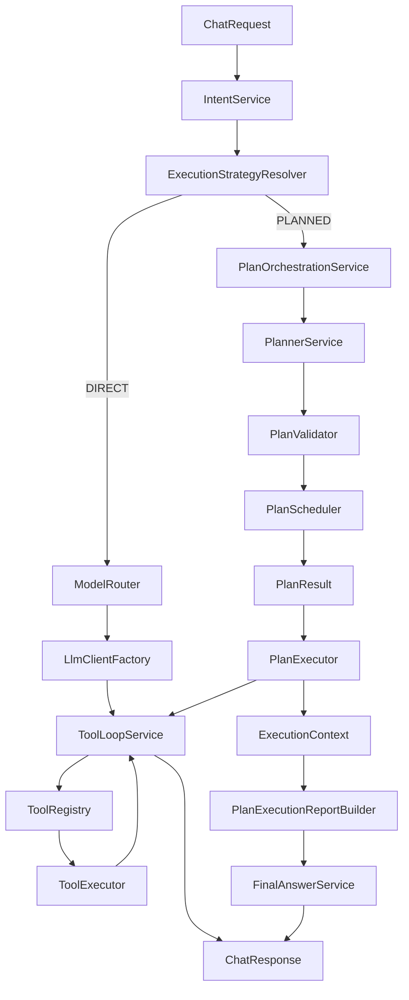
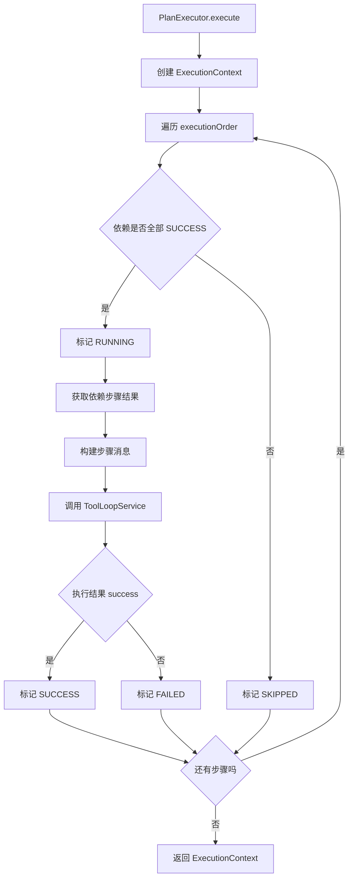

# 第八阶段：Agent Execution（智能体执行机制）

## 1. 阶段目标

第六阶段完成了 Tool Calling，第七阶段完成了 Planner，但这两项能力还没有形成完整的 Agent 执行闭环。

Tool Calling 解决的是模型如何调用工具。

Planner 解决的是如何将复杂任务拆解成多个步骤，并确定步骤之间的依赖关系。

Agent Execution 则负责真正执行计划，将 Planner 生成的 Plan 转化为实际执行过程。

本阶段主要实现：

1. 根据任务复杂度选择 DIRECT 或 PLANNED 执行策略。
2. 建立 Agent 执行上下文，记录每个步骤的执行状态和结果。
3. 实现 PlanExecutor，按照计划执行任务。
4. 将前置步骤的执行结果传递给后续步骤。
5. 实现步骤失败处理、依赖跳过和整体执行结果汇总。
6. 将执行报告交给模型，生成最终自然语言答案。
7. 支持 Planner 使用会话历史，解决多轮对话中的指代问题。

最终形成完整的 Agent 执行闭环。

---

## 2. 整体架构

### 2.1 执行策略分流

并不是所有任务都需要 Planner。

例如：

- 普通知识问答：直接调用模型。
- 单次工具调用：直接使用 ToolLoopService。
- 简单的连续工具调用：直接使用 ToolLoopService。
- 多步骤任务，且步骤之间存在结果依赖：使用 Planner 和 PlanExecutor。

因此采用 DIRECT / PLANNED 两种执行策略。



DIRECT 和 PLANNED 是两条不同的任务执行路径，但底层复用了 ToolLoopService、ToolRegistry 和 ToolExecutor。

这样可以避免为计划执行再实现一套独立的工具调用机制。

### 2.2 执行策略判断

执行策略判断采用 Java 规则优先、小模型兜底的方式。

执行过程：

1. ExecutionStrategyResolver 首先执行 Java 启发式规则。
2. 如果 Java 规则能够明确判断，则直接返回策略。
3. 如果规则无法确定，则调用 StrategyClassifier。
4. StrategyClassifier 使用独立配置的小模型判断 DIRECT 或 PLANNED。

相关数据结构：

```java
public enum ExecutionStrategy {
    DIRECT,
    PLANNED
}

public record StrategyContext(
        String userMessage,
        IntentResult intentResult,
        String conversationId,
        List<ChatMessage> history
) {}

public record StrategyResult(
        ExecutionStrategy strategy,
        String reason
) {}
```

需要注意：

IntentType 和 ExecutionStrategy 是两个不同维度。

IntentType 表示用户想做什么。

ExecutionStrategy 表示应该采用什么执行方式。

不能简单地将某个意图类型固定映射为 PLANNED，因为同一种意图可能对应简单任务，也可能对应复杂任务。

---

## 3. Agent 执行上下文

### 3.1 为什么需要 ExecutionContext

Planner 只负责生成执行计划，不负责保存实际执行过程。

例如：

```text
step_1：计算 128 × 256
step_2：将 step_1 的结果乘以 2
```

执行过程中需要知道：

- 哪些步骤已经完成？
- 哪些步骤正在执行？
- 哪些步骤执行失败？
- 每个步骤产生了什么结果？
- 后续步骤是否具备执行条件？

因此引入 ExecutionContext。

### 3.2 步骤状态

```java
public enum StepExecutionStatus {
    PENDING,
    RUNNING,
    SUCCESS,
    FAILED,
    SKIPPED
}
```

状态说明：

| 状态 | 含义 |
|---|---|
| PENDING | 等待执行 |
| RUNNING | 正在执行 |
| SUCCESS | 执行成功 |
| FAILED | 执行失败 |
| SKIPPED | 因依赖条件不满足而跳过 |

### 3.3 StepExecution

每个步骤对应一份执行记录。

```java
public record StepExecution(
        StepExecutionStatus status,
        Object result,
        String error
) {}
```

字段说明：

- status：当前步骤执行状态。
- result：步骤执行成功后的结果。
- error：失败原因或跳过原因。

### 3.4 ExecutionContext

ExecutionContext 是整个计划执行期间的状态容器。

核心字段：

```java
public class ExecutionContext {

    private final PlanResult planResult;

    private final Map<String, StepExecution> stepExecutions;
}
```

使用 LinkedHashMap 保存步骤执行记录，以保持计划拓扑顺序。

主要职责：

1. 初始化所有步骤为 PENDING。
2. 记录步骤开始执行。
3. 记录步骤执行成功。
4. 记录步骤执行失败。
5. 记录步骤被跳过。
6. 提取前置依赖步骤的执行结果。
7. 判断当前步骤的依赖是否满足。
8. 汇总整个计划的执行状态。

对外返回不可修改的执行记录视图，并通过状态更新方法修改内部状态。

### 3.5 整体执行状态

```java
public enum PlanExecutionStatus {
    SUCCESS,
    PARTIAL_SUCCESS,
    FAILED
}

public record PlanExecutionSummary(
        PlanExecutionStatus status,
        int totalSteps,
        int successCount,
        int failedCount,
        int skippedCount
) {}
```

汇总规则：

- 所有步骤成功：SUCCESS。
- 至少一个步骤成功，同时存在失败或跳过：PARTIAL_SUCCESS。
- 没有任何步骤成功：FAILED。

---

## 4. PlanExecutor

### 4.1 核心职责

PlanExecutor 是计划执行的核心组件。

它不负责重新规划任务，也不负责重新实现工具调用逻辑。

它主要负责：

1. 接收 PlanResult。
2. 创建 ExecutionContext。
3. 按照 executionOrder 遍历步骤。
4. 检查步骤依赖是否满足。
5. 执行当前步骤。
6. 保存执行结果。
7. 处理步骤异常。
8. 返回最终 ExecutionContext。

### 4.2 执行流程



### 4.3 工具调用复用

PlanExecutor 不直接调用具体工具。

它将当前步骤描述和前置步骤结果组装成消息，再交给 ToolLoopService。

例如：

```text
当前步骤任务：
将 step_1 的计算结果乘以 2。

前置依赖步骤的结果：
step_1 = 32768
```

之后由模型决定是否需要调用工具，以及调用什么工具。

底层仍然使用原有 Tool Calling 闭环：

ToolLoopService → ToolRegistry → ToolExecutor。

### 4.4 步骤结果传递

PlanExecutor 只提取当前步骤直接依赖的结果。

例如：

```text
step_1：计算 128 × 256
step_2：将 step_1 的结果乘以 2
step_3：将 step_2 的结果加上 100
```

执行过程：

```text
step_1 = 32768
step_2 = 65536
step_3 = 65636
```

每个步骤的结果保存在 ExecutionContext 中。

后续步骤通过 dependsOn 获取对应的前置步骤结果。

注意：Plan 只描述依赖关系，并不会自动传递结果。结果传递是 PlanExecutor 的职责。

### 4.5 失败处理

当前版本采用单步骤失败后继续执行的策略。

例如：

```text
step_1：计算 128 × 256
step_2：调用一个不存在的工具
step_3：将 step_1 的结果乘以 2
```

如果 step_2 执行失败：

- step_2 标记为 FAILED。
- 如果 step_3 只依赖 step_1，则仍然可以执行。
- 如果后续步骤依赖 step_2，则因为依赖不满足而标记为 SKIPPED。
- 无关步骤继续执行。

当前版本没有实现失败后终止整个计划、自动重试计划步骤等可配置策略。

---

## 5. ToolLoopResult：工具调用结果与恢复机制

原有 ToolLoopService 主要返回模型最终答案。

为了让 PlanExecutor 感知工具调用是否存在未恢复的失败，引入：

```java
public record ToolLoopResult(
        String answer,
        boolean success
) {}
```

当前版本采用基于工具名称的简化失败恢复机制。

基本逻辑：

1. 工具执行失败时，记录对应工具的未恢复失败次数。
2. 模型再次调用同名工具且执行成功时，减少对应失败次数。
3. 模型结束工具调用循环时，根据是否还存在未恢复失败判断 success。
4. 如果仍然存在未恢复失败，则返回 success=false。

工具调用最大轮数由配置控制，当前默认值为 5。

需要注意：

- maxRounds 统计的是工具调用轮数，不是工具调用总次数。
- 当前恢复机制是简化的启发式机制。
- 同名工具调用成功并不一定代表之前的业务任务真正恢复成功。

### 已知限制

如果模型没有发起工具调用，而是直接通过自然语言表示无法完成任务，当前 ToolLoopService 可能仍然返回 success=true。

原因是：

当前实现主要根据 Java 工具执行记录判断失败，没有完整区分模型正常结束和步骤任务真正完成。

T4 测试暴露了这一问题。

当前版本决定暂不引入复杂的结构化步骤结果协议，作为已知限制保留。

未来接入真实业务工具时，需要重新设计工具执行结果和步骤成功判定机制，不能仅依赖模型的自然语言回答。

---

## 6. 最终答案生成

PlanExecutor 返回 ExecutionContext 后，不直接将所有执行对象交给用户。

当前设计分为两个环节：

### 6.1 PlanExecutionReportBuilder

负责将 ExecutionContext 转换成结构化文本执行报告。

报告包含：

- 整体执行状态。
- 总步骤数量。
- 成功数量。
- 失败数量。
- 跳过数量。
- 每个步骤的任务描述。
- 每个步骤的执行结果或失败原因。

### 6.2 FinalAnswerService

将以下信息提交给模型：

- 用户原始问题。
- 结构化执行报告。
- 指定的模型 ID。

模型根据执行报告组织自然语言答案。

Prompt 要求：

1. 只能依据执行报告组织答案。
2. 不得编造工具执行结果。
3. 明确区分成功、失败和跳过。
4. 保留重要计算结果。
5. 不得将失败步骤描述为成功。

最终形成：

PlanExecutor → ExecutionContext → PlanExecutionReportBuilder → FinalAnswerService → ChatResponse。

---

## 7. Planner 接入会话历史

### 7.1 问题背景

原先 Planner 只接收用户当前消息。

例如：

第一轮：

```text
计算 128 × 256，然后把结果乘以 2。
```

第二轮：

```text
再把刚才的最终结果乘以 3。
```

第二轮的用户消息本身没有包含具体数字。

如果 Planner 只看当前消息，就无法准确理解“刚才的最终结果”。

### 7.2 改造方案

最终采用独立 history 参数，而不是在 ChatService 中拼接用户问题。

调用链：

```text
ChatService
    ↓
PlanOrchestrationService.createPlan(userMessage, history)
    ↓
PlannerService.createPlan(userMessage, history)
    ↓
构建 LLM messages
    ↓
生成 Plan
```

设计原则：

- userMessage 始终只代表本轮用户任务。
- history 用于理解历史对话和指代关系。
- 历史消息放在当前用户任务之前。
- 历史任务不代表需要在本轮重新执行。

### 7.3 验收结果

第一轮：

```text
计算 128 × 256，然后把结果乘以 2。
```

结果：

```text
65536
```

第二轮：

```text
再把刚才的最终结果乘以 3。
```

结果：

```text
196608
```

T5 测试通过，证明 Planner 能够结合历史消息理解多轮指代，并生成正确的执行计划。

---

## 8. 测试与验收

本阶段主要完成以下测试：

| 测试 | 测试目标 | 结果 |
|---|---|---|
| T1 | 普通知识问答走 DIRECT | 通过 |
| T2 | 单次工具调用走 DIRECT | 通过 |
| T3 | 多步骤任务走 PLANNED，正确传递结果 | 通过 |
| T4 | 步骤失败隔离及无关步骤继续执行 | 暴露已知边界问题，暂接受 |
| T5 | 多轮对话中 Planner 使用历史上下文 | 通过 |

### T4 的已知问题

测试中，模型收到调用不存在工具的任务后，没有真正返回 tool_calls，而是直接通过自然语言说明工具不存在。

由于 Java 没有记录到工具执行失败，最终可能将该步骤标记为 SUCCESS。

当前版本接受该限制，暂不扩展步骤结果协议。

因此 T4 不是严格意义上的完全通过。

### 阶段验收结论

用户已确认本阶段整体实现及端到端验收完成。

DIRECT / PLANNED 分流、PlanExecutor、结果传递、失败隔离、执行报告、多轮历史上下文等核心能力均已完成。

---

## 9. 当前遗留事项

以下事项暂不纳入本阶段实现。

### 9.1 条件分支

例如：

```text
第一步：查询日志。

第二步：如果发现数据库连接异常，则查询数据库。

第三步：整理诊断报告。
```

当前 PlanExecutor 主要依赖静态 dependsOn 关系，不支持完整的 IF / ELSE 执行分支。

该能力暂缓，后续单独设计。

### 9.2 NEED_INPUT

未来需要区分：

- SUCCESS：步骤完成。
- FAILED：步骤执行失败。
- NEED_INPUT：需要用户补充信息。

NEED_INPUT 还涉及暂停计划、保存执行现场、等待用户回复和恢复执行。

当前不实现。

### 9.3 更可靠的执行结果协议

未来需要区分：

- 模型正常结束。
- 工具执行成功。
- 工具执行失败。
- 步骤任务真正完成。
- 步骤需要用户补充信息。

不能仅凭模型返回自然语言判断步骤成功。

### 9.4 执行策略与恢复机制

后续可考虑：

- 计划级超时。
- 工具调用总次数限制。
- 可配置失败处理策略。
- 步骤重试。
- 执行现场持久化。
- 并发执行无依赖步骤。

以上均不属于当前版本已实现能力。

---

## 10. 本阶段最终成果

完成第八阶段后，Jarvis 已经从单纯的工具调用系统发展为具有基础任务规划和执行能力的 Agent。

当前核心能力：

1. 理解用户意图。
2. 判断任务执行策略。
3. 将复杂任务拆解为多个步骤。
4. 校验计划依赖关系。
5. 按拓扑顺序执行任务。
6. 复用 Tool Calling 完成实际操作。
7. 保存步骤执行状态和结果。
8. 将前置步骤结果传递给后续步骤。
9. 隔离步骤失败，继续执行无关任务。
10. 汇总执行报告并生成最终答案。
11. 使用会话历史理解多轮任务。

下一阶段进入：

**第九阶段：RAG / 知识库**

目标是让 Jarvis 能够从外部业务文档、技术文档和知识库中检索相关信息，并将检索结果作为模型回答和 Agent 任务执行的可靠依据。

最终逐步向 AIOps 故障诊断 Agent 发展。