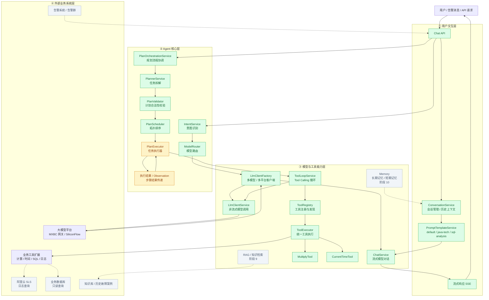

# Jarvis 总架构图

> 维护方式：每完成一个阶段，把对应节点从 `building` 移入 `done`；新规划的能力标 `future`。
>
> 图例：🟩 `done`（已完成并验收） / 🟨 `building`（进行中） / ⬜ `future`（规划中，虚线连接）

## 当前状态一览

| 层 | 节点 | 状态 |
|---|---|---|
| ① 用户交互层 | Chat API / SSE / ConversationService / PromptTemplateService | ✅ done（阶段 2、3） |
| ② Agent 核心层 | IntentService / ModelRouter | ✅ done（阶段 5） |
| ② Agent 核心层 | PlannerService / PlanValidator / PlanScheduler / PlanOrchestrationService | ✅ done（阶段 7，7.6 验收中） |
| ② Agent 核心层 | **PlanExecutor / Observation** | 🔨 building（当前阶段） |
| ③ 模型与工具能力层 | LlmClientFactory / ChatService / LlmClientService / ToolLoopService / ToolRegistry / ToolExecutor / MultiplyTool / CurrentTimeTool | ✅ done（阶段 4、6） |
| ④ 外部业务系统层 | RAG / Memory / SLS / DB / 告警 / 知识库 | ⬜ future（阶段 9、10） |
